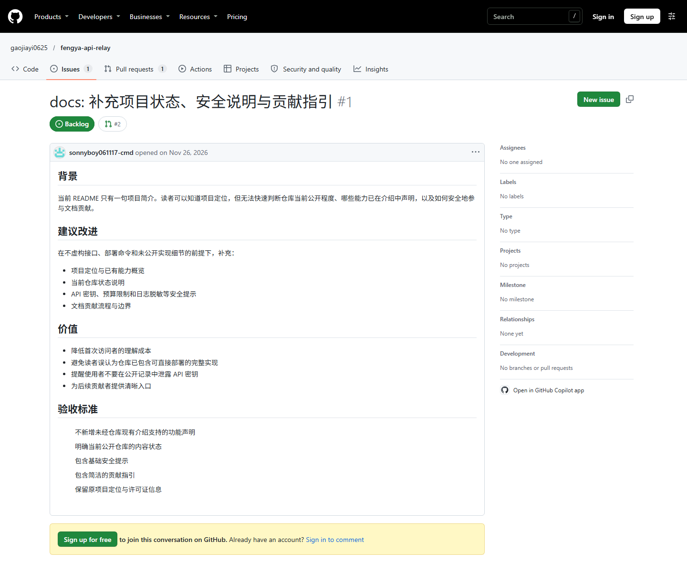
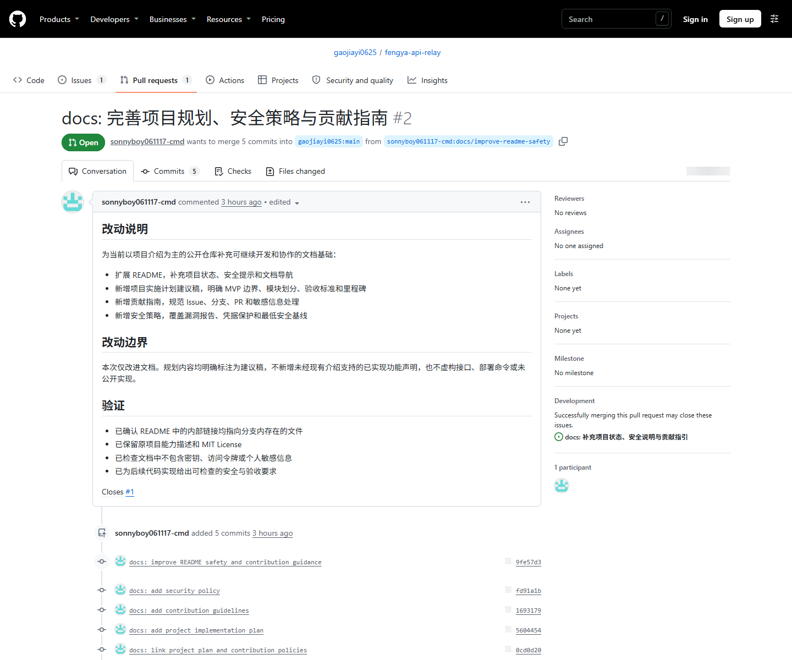

# Calder Claim Material Checker

卡尔德保险单笔报案材料核对 Demo。

> 当前仓库正在通过 Issue 与 Pull Request 完成首个可运行版本。所有人物、案件与数据均为合成训练内容。

## 在线体验

[打开公开 Demo](https://calder-claim-material-checker.ochrelynx7.chatgpt.site/)

## 外部协作证明

本项目实践包含向其他公开仓库提交 Issue 和 Pull Request。以下记录均可点击查看 GitHub 原始页面。

### Issue

[gaojiayi0625/fengya-api-relay Issue #1：补充项目状态、安全说明与贡献指引](https://github.com/gaojiayi0625/fengya-api-relay/issues/1)

### Pull Request

[gaojiayi0625/fengya-api-relay PR #2：完善项目规划、安全策略与贡献指南](https://github.com/gaojiayi0625/fengya-api-relay/pull/2)

## 说明

- Issue 和 PR 提交至第三方公开仓库 `gaojiayi0625/fengya-api-relay`。
- PR 当前包含 README、项目实施计划、安全策略和贡献指南。
- 截图仅用于展示公开协作记录，不包含账号密码、访问令牌或其他敏感信息。
